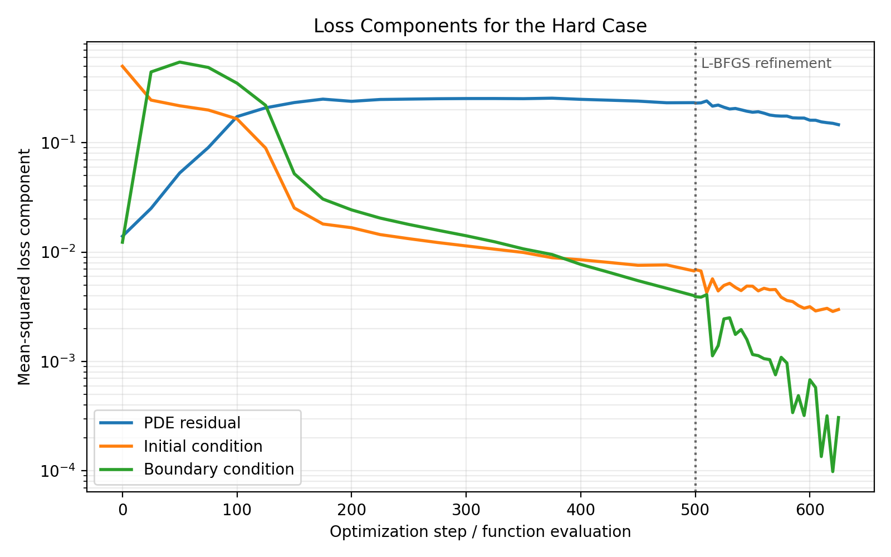
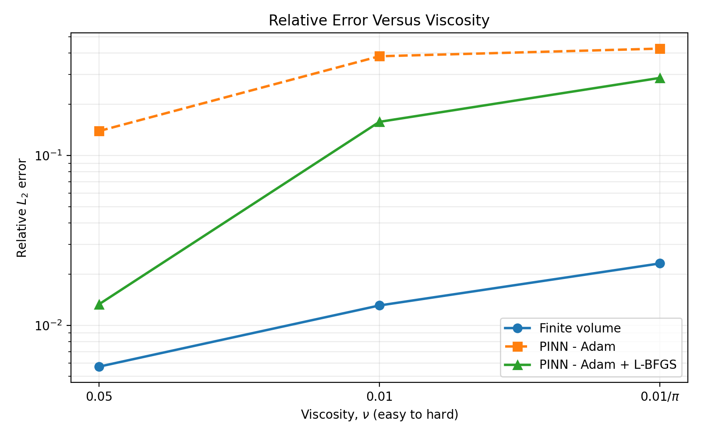
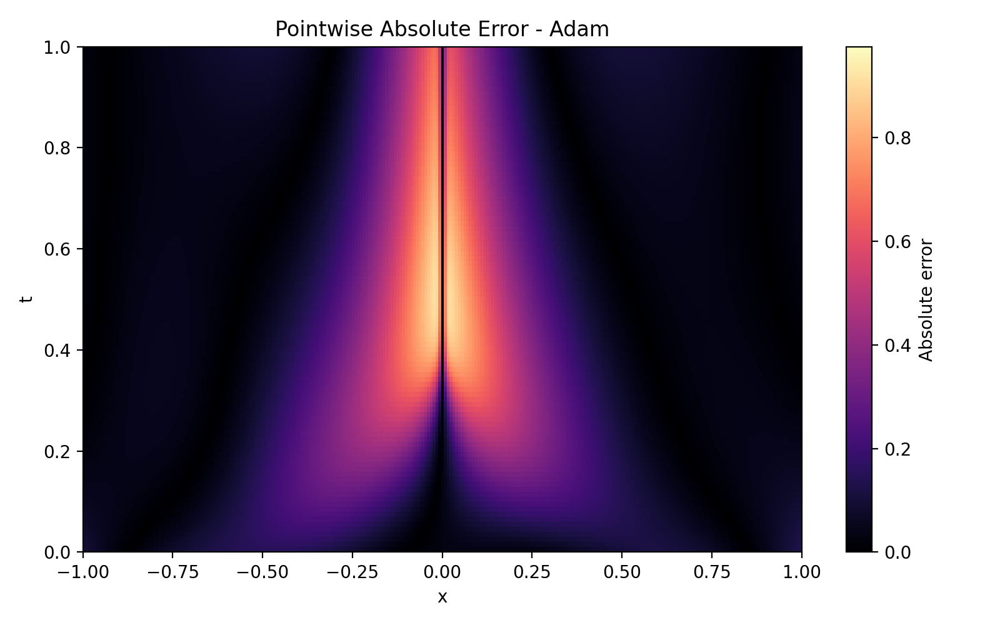
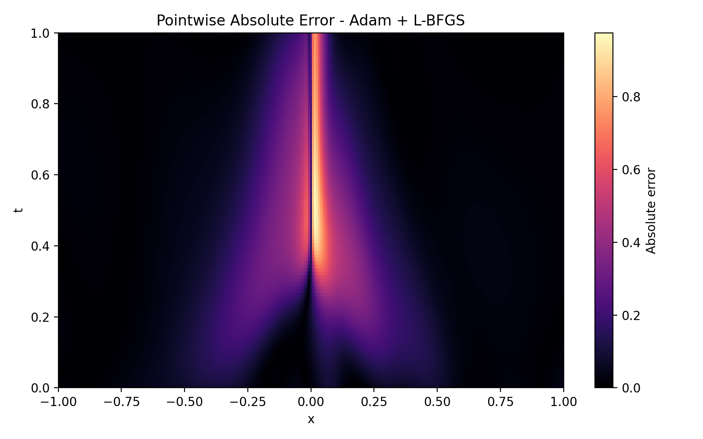
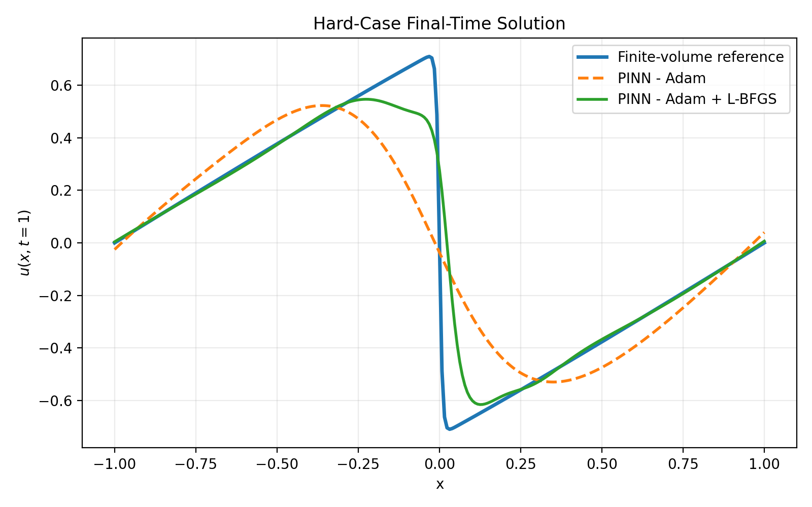
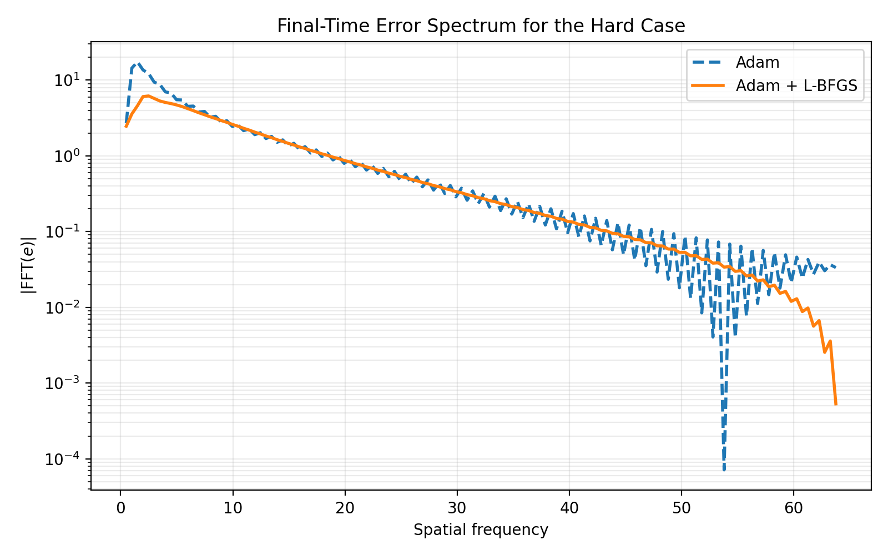
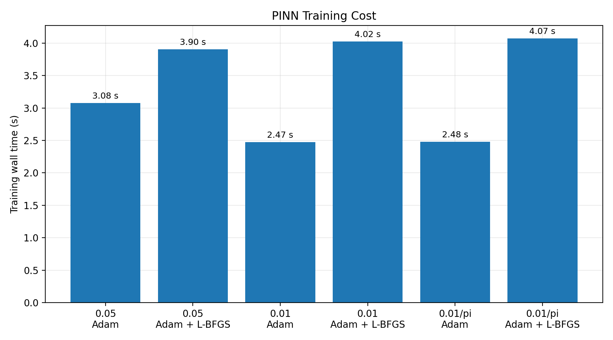

# Project 3: Diagnosing and Improving PINN Training for the 1-D Viscous Burgers Equation

## Abstract

This project studies the failure of a physics-informed neural network (PINN) on a convection-dominated nonlinear partial differential equation and tests a targeted optimization remedy. The minimal case is the one-dimensional viscous Burgers equation,

```math
u_t + u u_x - \nu u_{xx}=0
```

with viscosity $\nu$ used as the difficulty parameter. Decreasing viscosity sharpens the internal solution layer and makes the PINN increasingly difficult to train. A semi-implicit finite-volume method is used as the conventional baseline and numerical reference. The baseline PINN is trained with Adam, while the proposed Path C remedy keeps the architecture, training points, seed, and loss weights fixed and adds an L-BFGS refinement stage after Adam.

Across $\nu=0.05$, $0.01$, and $0.01/\pi$, the Adam-only PINN obtains relative $L_2$ errors of $13.91\%$, $38.35\%$, and $42.54\%$, respectively. Adam followed by L-BFGS reduces these errors to $1.33\%$, $15.76\%$, and $28.59\%$. A controlled supervised-capacity test on the hardest case reaches $5.57\%$ error with the same network architecture, showing that the network can represent the solution substantially better than physics-informed training is able to recover. The evidence therefore identifies optimization as a major failure mechanism, while the remaining low-viscosity error shows that sharp-gradient and high-frequency effects are not eliminated by the optimizer change.

For a single forward solve, the finite-volume method remains more accurate and less expensive than either PINN formulation. The main conclusion is that an Adam-only PINN is not a competitive forward solver for this problem, and that optimizer choice materially affects the credibility of PINN results in sharp nonlinear transport problems.

---

## 1. Outreach Log and Project Scope

Project 3 is designed around a researcher interview followed by a minimal PINN/PINO case study. The team did **not** complete the required researcher outreach and interview before the project deadline because team coordination did not produce a timely outreach effort. No researcher interaction is fabricated in this report.

As a result, this submission should be read as a complete **independent technical case study** rather than a researcher-validated field deployment. The following required researcher-specific elements are therefore not claimed:

- no ASU researcher was interviewed;
- no researcher-specific solver cost or accuracy threshold was collected;
- no researcher reviewed the problem brief;
- no recommendation memo was sent to a researcher;
- no researcher response is reported.

The technical study still follows the Project 3 diagnostic structure: a conventional baseline, loss-component tracking, error versus a controlled difficulty parameter, spatial/frequency error diagnostics, cost measurements, a controlled failure diagnosis, and a targeted Path C fix.

---

## 2. Problem Brief — Independent and Not Researcher-Validated

Physics-informed neural networks approximate a PDE solution with a neural network while enforcing the governing equations through the training loss. They are attractive when physics and sparse data must be combined in one model, but they can be difficult to optimize when the PDE solution contains sharp gradients, multiple scales, or competing loss terms.

The viscous Burgers equation provides a compact test problem that contains two important features:

1. **nonlinear transport**, through the $u u_x$ term; and
2. **diffusion**, controlled by the viscosity $\nu$.

As viscosity decreases, nonlinear steepening dominates diffusion and the solution forms a thin internal layer. This gives a controlled way to make the same PDE progressively harder without changing the network architecture or training procedure.

The central question is:

> **As the Burgers solution becomes sharper, is PINN failure primarily caused by insufficient network capacity or by difficulty optimizing the physics-informed loss, and can an L-BFGS refinement improve the result without changing the model architecture?**

This project uses **Path C: diagnosis plus fix**. The controlled diagnosis separates expressivity from optimization, and the fix targets the optimization mechanism directly.

### 2.1 Value and computational bottleneck

Because no researcher was interviewed, this report does not claim a laboratory- or industry-specific value proposition. The value of the case study is methodological: it tests whether a PINN remains reliable as nonlinear transport produces a sharp solution feature. In this independent study, the conventional finite-volume solver is the current comparison method and requires approximately $0.02$ s per forward solve on the recorded CPU run. The specific computational challenge is not conventional-solver cost; it is the degradation of physics-informed training as the solution becomes sharper.

### 2.2 Prior PINN context

The Burgers equation is a standard PINN benchmark, and published PINN literature has documented optimization and training failures on increasingly difficult PDE regimes. Those publications motivate the controlled diagnosis used here, but they do **not** substitute for a researcher interview.

### 2.3 Researcher review status

This problem brief was **not reviewed by a researcher**. That missing validation is an explicit project limitation rather than an assumed or fabricated interaction.

---

## 3. Minimal Case Formulation

### 3.1 Governing PDE

The one-dimensional viscous Burgers equation is

```math
\frac{\partial u}{\partial t}
+ u\frac{\partial u}{\partial x}
- \nu\frac{\partial^2 u}{\partial x^2}
=0
```

on the space-time domain

```math
x\in[-1,1], \qquad t\in[0,1].
```

The initial condition is

```math
u(x,0)=-\sin(\pi x).
```

and the boundary conditions are

```math
u(-1,t)=u(1,t)=0.
```

### 3.2 Difficulty parameter

Viscosity is the controlled difficulty parameter:

| Case | Viscosity $\nu$ | Interpretation |
|---|---:|---|
| Easy | $0.05$ | diffusion keeps the solution relatively smooth |
| Intermediate | $0.01$ | nonlinear steepening becomes stronger |
| Hard | $0.01/\pi\approx 0.003183$ | a sharp internal layer develops |

This one-dimensional case is intentionally simpler than a full CFD application: it removes complex geometry, multidimensional flow, and turbulence. It preserves the feature that matters for this study, however—the competition between nonlinear steepening and diffusion. As viscosity decreases, that competition creates an increasingly thin internal layer with stronger high-frequency content. The simplification therefore removes unrelated complexity without removing the targeted PINN failure mechanism.

Thus,

```math
\nu\downarrow
\;\Longrightarrow\;
\text{thinner internal layer}
\;\Longrightarrow\;
\text{higher spatial-frequency content}
\;\Longrightarrow\;
\text{harder PINN training}.
```

### 3.3 PINN approximation

A fully connected tanh neural network takes $(x,t)$ as input and returns

```math
u_\theta(x,t)
```

where $\theta$ contains all trainable weights and biases. Automatic differentiation is used to compute

```math
\frac{\partial u_\theta}{\partial t},
\qquad
\frac{\partial u_\theta}{\partial x},
\qquad
\frac{\partial^2 u_\theta}{\partial x^2}.
```

The physics residual is

```math
f_\theta(x,t)
=
\frac{\partial u_\theta}{\partial t}
+u_\theta\frac{\partial u_\theta}{\partial x}
-\nu\frac{\partial^2 u_\theta}{\partial x^2}.
```

The loss contains separate PDE, initial-condition, and boundary-condition terms:

```math
\mathcal{L}(\theta)
=
\mathcal{L}_{\mathrm{PDE}}
+10\mathcal{L}_{\mathrm{IC}}
+\mathcal{L}_{\mathrm{BC}}.
```

The PDE term is

```math
\mathcal{L}_{\mathrm{PDE}}
=
\frac{1}{N_f}\sum_{i=1}^{N_f}
\left|f_\theta(x_i,t_i)\right|^2.
```

and the initial-condition term is

```math
\mathcal{L}_{\mathrm{IC}}
=
\frac{1}{N_0}\sum_{i=1}^{N_0}
\left|u_\theta(x_i,0)+\sin(\pi x_i)\right|^2.
```

The boundary term penalizes the two homogeneous Dirichlet boundaries.

### 3.4 Fixed training configuration

The controlled comparison uses the same configuration for every viscosity and both PINN variants:

| Setting | Value |
|---|---:|
| Random seed | 0 |
| Hidden width | 48 neurons |
| Hidden depth | 3 layers |
| Activation | tanh |
| Collocation points | 700 |
| Initial-condition points | 256 |
| Boundary points | 256 |
| Adam learning rate | $10^{-3}$ |
| Adam epochs | 500 |
| PDE loss weight | 1 |
| Initial-condition weight | 10 |
| Boundary-condition weight | 1 |
| L-BFGS maximum iterations | 120 |

The only intentional difference between the two PINN solvers is the addition of L-BFGS after the common Adam phase.

---

## 4. Experiments and Diagnostic Plan

The experiment compares four methods or diagnostics:

1. **Finite-volume baseline.** A semi-implicit finite-volume solver using a Rusanov flux for convection and implicit diffusion.
2. **PINN — Adam.** The baseline physics-informed neural network trained for 500 Adam epochs.
3. **PINN — Adam + L-BFGS.** The same PINN after the same Adam phase, followed by L-BFGS refinement.
4. **Supervised capacity test.** The same network architecture trained directly on numerical reference values for the hardest viscosity. This is used only to diagnose expressivity versus optimization; it is not proposed as the PDE solver.

The main solution-error metric is the relative $L_2$ error

```math
E_{\mathrm{rel}}
=
\frac{\left\|u_{\mathrm{pred}}-u_{\mathrm{ref}}\right\|_2}
{\left\|u_{\mathrm{ref}}\right\|_2}.
```

The high-resolution finite-volume solution uses 1025 spatial points. A 257-point finite-volume solution is used as the lower-cost conventional baseline, and all PINN solutions are evaluated on the same 257-by-101 space-time grid.

| Required diagnostic | Evidence in this report |
|---|---|
| P1 — Baseline | finite-volume accuracy and wall-clock time |
| P2 — Loss components | separate PDE, initial-condition, and boundary losses |
| P3 — Error vs. knob | relative $L_2$ error across the viscosity sweep |
| P4 — Error location | pointwise error fields, final-time profile, and Fourier spectrum |
| P5 — Cost | PINN training/evaluation time and finite-volume solve time |
| Path C | controlled capacity diagnosis plus Adam $\rightarrow$ L-BFGS remedy |

---
## 5. P1 — Conventional Baseline

The conventional solver discretizes the convective term with a Rusanov finite-volume flux and advances diffusion implicitly. The 1025-point result is treated as the numerical reference for the reported error calculation.

| Viscosity $\nu$ | FV-257 relative $L_2$ error | FV solve time |
|---:|---:|---:|
| 0.05 | 0.00570 | 0.0149 s |
| 0.01 | 0.01307 | 0.0188 s |
| $0.01/\pi$ | 0.02311 | 0.0180 s |

The lower-resolution finite-volume solver remains below $2.4\%$ relative error for every tested viscosity and requires only about $0.02$ s per solve on the recorded CPU run. It therefore provides a strong conventional baseline for this small forward problem.

---

## 6. P2 — Loss Components

The PDE, initial-condition, and boundary-condition losses are logged separately throughout training.



For the hard case, Adam reduces the weighted total loss from approximately $5.02$ at initialization to $0.303$ after 500 epochs. L-BFGS then reduces the recorded total loss further to approximately $0.176$. The refinement therefore continues to make progress after the fixed Adam budget has largely slowed.

The loss history is useful diagnostically, but loss value alone is not taken as proof of solution accuracy. All conclusions are based on comparison with the numerical reference.

---

## 7. P3 — Error Versus Difficulty Parameter

The difficulty is increased by decreasing viscosity while every PINN hyperparameter is held fixed.

| Viscosity $\nu$ | Finite volume | PINN — Adam | PINN — Adam + L-BFGS | Error reduction from L-BFGS |
|---:|---:|---:|---:|---:|
| 0.05 | 0.57% | 13.91% | **1.33%** | **90.5%** |
| 0.01 | 1.31% | 38.35% | **15.76%** | **58.9%** |
| $0.01/\pi$ | 2.31% | 42.54% | **28.59%** | **32.8%** |



Two trends are clear.

First, the Adam-only PINN becomes substantially less accurate as the viscosity decreases. The error grows from $13.91\%$ in the smoothest case to $42.54\%$ in the sharpest case.

Second, L-BFGS improves the result at every viscosity, but the improvement becomes less complete as the internal layer sharpens. The hard-case error remains $28.59\%$, which is far above the $2.31\%$ error of the finite-volume baseline.

Therefore, the optimizer fix is useful but not sufficient to make the PINN competitive on the most convection-dominated case.

---

## 8. Controlled Diagnosis — Expressivity Versus Optimization

A central Path B/C question is whether the PINN fails because the neural network cannot represent the solution or because the physics-informed training objective does not find a good representation.

To separate these explanations, the **same network architecture** is trained directly on 5,000 numerical reference samples for the hardest viscosity.

| Hard-case model | Relative $L_2$ error |
|---|---:|
| PINN — Adam | 42.54% |
| PINN — Adam + L-BFGS | 28.59% |
| Same network — supervised capacity test | **5.57%** |

The supervised network is not a replacement solver because it is given reference solution values. Its purpose is diagnostic. Since the same architecture reaches $5.57\%$ error when directly supervised, the network has substantially more representational capacity than the physics-informed optimization is exploiting.

This result supports the diagnosis that **PINN failure is substantially optimization-limited**.

At the same time, the supervised result is not exact, and the L-BFGS PINN remains much worse than the supervised fit. This indicates that sharp-gradient representation and spectral effects remain relevant in the hard case.

---

## 9. P4 — Spatial and Spectral Error Structure

### 9.1 Pointwise error





The largest errors are concentrated around the evolving sharp internal layer. L-BFGS reduces the error magnitude and localizes the transition more effectively, but it does not remove the dominant layer error.

### 9.2 Final-time solution



At $t=1$, the finite-volume reference contains a narrow transition near the center of the domain. The Adam-only PINN smooths this feature heavily. L-BFGS recovers a much sharper transition, but the location and shape still differ from the numerical reference.

### 9.3 Fourier error spectrum



The optimizer refinement reduces low- and mid-frequency error substantially, but non-negligible error persists over the higher spatial frequencies associated with the sharp layer. This is consistent with the observation that optimization is a major bottleneck but not the only remaining limitation.

---
## 10. P5 — Computational Cost

The recorded timings come from a CPU-only run using four PyTorch threads. They are machine-dependent and are included to show order of magnitude rather than universal performance.

| Viscosity $\nu$ | Method | Training time | Evaluation time |
|---:|---|---:|---:|
| 0.05 | PINN — Adam | 3.13 s | 0.0260 s |
| 0.05 | PINN — Adam + L-BFGS | 3.93 s | 0.0200 s |
| 0.01 | PINN — Adam | 3.38 s | 0.0121 s |
| 0.01 | PINN — Adam + L-BFGS | 3.90 s | 0.0109 s |
| $0.01/\pi$ | PINN — Adam | 3.08 s | 0.0117 s |
| $0.01/\pi$ | PINN — Adam + L-BFGS | 3.92 s | 0.0093 s |



The finite-volume forward solve takes approximately $0.015$–$0.019$ s, while PINN training requires several seconds. The trained PINN also does not provide an accuracy advantage. Therefore, there is no favorable cost argument for replacing the finite-volume method with a PINN for a **single forward Burgers solve**.

A break-even query count $N^\star$ is not reported because this project trains a separate PINN for each PDE instance rather than a neural operator or reusable parametric surrogate.

---

## 11. Path C Remedy

### 11.1 Identified failure mechanism

The controlled capacity test and optimizer comparison indicate that a large portion of the error is caused by the difficulty of optimizing the physics-informed objective:

- the architecture reaches $5.57\%$ error when trained directly on reference data;
- the Adam PINN reaches only $42.54\%$ error on the same hard case;
- adding L-BFGS reduces the PINN error to $28.59\%$ without changing the architecture, points, seed, or loss weights.

### 11.2 Proposed fix

The remedy is a two-stage optimization schedule:

1. **Adam** performs robust first-order descent during the early stage of training;
2. **L-BFGS** refines the full-batch objective using curvature information.

This fix directly targets the diagnosed optimization limitation rather than increasing model size or changing the PDE.

### 11.3 Before-and-after result

At the hardest viscosity,

```math
E_{\mathrm{Adam}}=0.4254.
```

while

```math
E_{\mathrm{Adam+L\text{-}BFGS}}=0.2859.
```

The relative error reduction is

```math
\frac{0.4254-0.2859}{0.4254}\times100\%
\approx32.8\%.
```

The fix is therefore effective but incomplete. A stronger follow-up would target the remaining sharp-feature error with methods such as Fourier features, adaptive sampling, domain decomposition, or adaptive loss weighting.

---

## 12. Recommendation Memo Status and Technical Recommendation

Because no researcher interview was completed, this section is a **technical recommendation based on the independent case study**, not a memo claimed to have been sent to a researcher.

For a single forward solve of a convection-dominated Burgers problem, a basic PINN should **not** replace the conventional finite-volume solver. The finite-volume method is both more accurate and substantially cheaper for the tested problem.

If a future application has a genuine reason to use a PINN—such as sparse inverse measurements, unknown PDE coefficients, or a need to combine observations and physics in a single inference problem—then the results here suggest three minimum safeguards:

1. validate the PINN against an independent conventional solution on a reduced case;
2. do not rely on Adam-only training for sharp-gradient problems;
3. inspect solution error and its spatial/frequency structure rather than judging success from the training loss alone.

The most useful next experiment would keep the Adam + L-BFGS schedule and add one sharp-feature remedy, such as Fourier features or residual-adaptive sampling, while preserving the same viscosity sweep and finite-volume baseline.

---

## 13. Assumptions and Limitations

1. **No researcher interview.** The project does not contain the researcher-specific context, solver constraints, accuracy target, or feedback required by the field-deployment portion of Project 3.
2. **Reduced model.** The Burgers equation is a minimal nonlinear transport problem and should not be treated as a quantitative surrogate for a specific CFD, heat-transfer, or multiphysics application.
3. **Numerical reference rather than exact solution.** The reported errors are measured against a high-resolution finite-volume solution, not a closed-form exact solution.
4. **Single architecture.** Network width, depth, and activation are held fixed to isolate optimization effects. The study is not an architecture search.
5. **Fixed loss weights.** The comparison uses fixed weights $(1,10,1)$ for PDE, initial-condition, and boundary losses. Adaptive or NTK-based weighting could change the outcome.
6. **Fixed point counts.** Collocation and boundary sampling are not adapted near the sharp layer.
7. **Finite optimization budgets.** Adam is limited to 500 epochs and L-BFGS to 120 iterations. Different budgets would change the exact errors and timing.
8. **CPU timing.** Wall-clock measurements are hardware- and software-dependent.
9. **No PINO break-even analysis.** This is a PINN study for individual PDE instances, not a reusable neural operator trained over a parameter family.
10. **Public Burgers data are optional.** The project supports downloading the classic `burgers_shock.mat` file for external checking, but the main reported results use internally generated finite-volume references.

---

## 14. Conclusion

This project investigated how PINN accuracy changes as a nonlinear transport problem becomes more convection dominated and whether a better optimizer can recover lost accuracy. Decreasing viscosity from $0.05$ to $0.01/\pi$ increased the Adam-only PINN error from $13.91\%$ to $42.54\%$. Adding an L-BFGS refinement reduced the error at every viscosity, including a reduction from $42.54\%$ to $28.59\%$ in the hardest case.

The supervised-capacity test provides the key diagnostic result. The same architecture reaches $5.57\%$ error when directly fitted to numerical reference values, so the large physics-informed error cannot be attributed only to lack of network capacity. Optimization is therefore a major failure mechanism. However, the persistent error around the sharp internal layer and in the higher-frequency spectrum shows that the optimizer fix does not fully resolve the underlying sharp-feature difficulty.

For this forward problem, the finite-volume method remains the preferred solver because it is faster and more accurate. The main practical lesson is that PINN performance must be evaluated against a credible numerical baseline and that optimizer choice can materially change the result without changing the network itself.

The submission is technically reproducible, but it intentionally does not claim the researcher-outreach, researcher-validated problem brief, or delivered recommendation memo that were not completed.

---

## 15. Reproducibility

From the repository root, install the dependencies:

```bash
python -m pip install -r requirements.txt
```

Run the complete experiment:

```bash
python run_all.py
```

This command:

1. generates high-resolution finite-volume reference solutions;
2. runs the 257-point finite-volume baselines;
3. trains the Adam and Adam + L-BFGS PINNs for all three viscosities;
4. runs the supervised capacity test for the hardest case;
5. saves metrics and loss histories;
6. regenerates all report figures.

The fixed seed and training configuration are recorded in

```text
results/environment.json
```

The numerical results are stored in

```text
results/metrics.csv
results/loss_history.csv
```

Optional public-data validation can be enabled with

```bash
python src/download_data.py
python run_all.py
```

Generated model weights, dense prediction arrays, and finite-volume binary data are excluded from version control because they can be reproduced by the scripts.

### Repository code map

| File | Purpose |
|---|---|
| `run_all.py` | runs experiments and figure generation |
| `src/run_experiments.py` | controls the viscosity sweep, baselines, PINN training, and capacity test |
| `src/pinn.py` | PINN architecture, loss terms, Adam/L-BFGS training, and supervised diagnostic |
| `src/numerics.py` | finite-volume Burgers solver and error calculation |
| `src/make_plots.py` | creates P2–P5 figures |
| `src/data_utils.py` | optional public MAT-file loading |
| `src/download_data.py` | optional public Burgers data download |

---

## References

1. M. Raissi, P. Perdikaris, and G. E. Karniadakis, “Physics-informed neural networks: A deep learning framework for solving forward and inverse problems involving nonlinear partial differential equations,” *Journal of Computational Physics*, vol. 378, pp. 686–707, 2019.
2. A. S. Krishnapriyan, A. Gholami, S. Zhe, R. M. Kirby, and M. W. Mahoney, “Characterizing possible failure modes in physics-informed neural networks,” *Advances in Neural Information Processing Systems*, 2021.
3. S. Wang, X. Yu, and P. Perdikaris, “When and why PINNs fail to train: A neural tangent kernel perspective,” *Journal of Computational Physics*, vol. 449, 110768, 2022.
4. S. Wang, S. Sankaran, and P. Perdikaris, “Respecting causality for training physics-informed neural networks,” *Computer Methods in Applied Mechanics and Engineering*, vol. 421, 116813, 2024.
5. Original PINN Burgers example and optional public reference data: `https://github.com/maziarraissi/PINNs`.
